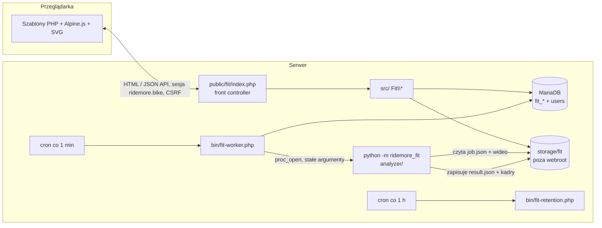
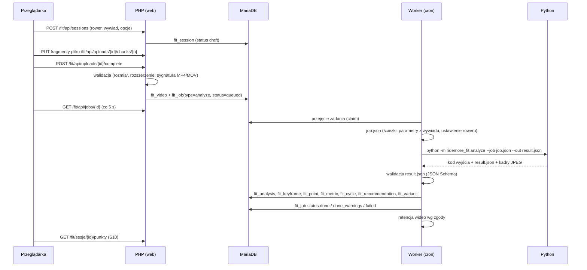

# 02 · Architektura

## 1. Warstwy

| Warstwa | Odpowiedzialność | Technologia | Nie robi |
|---|---|---|---|
| **A. Frontend** | ekrany, formularze, przesyłanie plików, nakładki SVG na kadrach, paski zakresów, korekta punktów (przeciąganie) | szablony PHP + Alpine.js + SVG | żadnych obliczeń biomechanicznych ani kątów |
| **B. Backend PHP** | sesja i uprawnienia, profile, rowery, ustawienia, wywiad, przyjmowanie plików, kolejka, worker, zapis wyników, API dla frontendu, retencja | PHP 8.2, PDO | analizy obrazu |
| **C. Baza** | dane użytkownika modułu, sesje, zadania, wyniki (podsumowania), historia, oceny | MariaDB, tabele `fit_*` | przechowywania wideo i dużych serii (te w plikach) |
| **D. Analiza obrazu** | odczyt i walidacja wideo, markery, model pozy, fuzja, śledzenie, kalibracja, cykle, kadry kluczowe, pomiary, jakość | Python 3.9, OpenCV, wybrany model pozy | dostępu do bazy, HTTP, logiki prezentacji |
| **E. Model dopasowania** | konfiguracja profili i zakresów, reguły zaleceń, model kinematyczny sylwetki, warianty symulacji, ocena zmiany | Python (moduł w `analyzer/`) + wersjonowane pliki JSON | dostępu do bazy |

Warstwy D i E działają w jednym procesie Pythona, ale są osobnymi pakietami (`ridemore_fit.vision`,
`ridemore_fit.fit`). Model dopasowania można uruchomić bez analizy wideo (zadania `correct`, `refit`, `simulate`).

## 2. Diagram komponentów



## 3. Struktura repozytorium (docelowa)

```
ridemorebikev2/
├─ CLAUDE.md, README.md
├─ docs/                       dokumentacja (ten katalog) + makiety
├─ public/fit/                 jedyny katalog publiczny modułu (podpinany pod /fit w Apache)
│  ├─ index.php                front controller
│  ├─ .htaccess                przepisanie na index.php, nagłówki bezpieczeństwa
│  └─ assets/                  css/, js/ (Alpine.js lokalnie), img/
├─ src/                        kod PHP (PSR-4: Fit\)
│  ├─ Http/                    Router, Request, Response, Controllers/, Middleware/ (Auth, Csrf)
│  ├─ Domain/                  Rider/, Bike/, Interview/, Session/, Analysis/, Recommendation/, Change/, Comfort/
│  ├─ Infra/                   Db (PDO), Repositories/, Storage, Queue, PythonRunner, Clock, Logger
│  └─ View/                    renderer szablonów
├─ templates/                  szablony stron (S01–S14) i fragmenty
├─ bin/                        fit-worker.php, fit-retention.php, fit-migrate.php
├─ migrations/                 NNN_opis.sql
├─ config/                     config.example.php (config.php poza repo), questionnaire-q-1.json (kwestionariusz,
│                              progi kategorii mobilności – wspólny dla PHP i Pythona)
├─ analyzer/                   pakiet Python (warstwy D i E)
│  ├─ ridemore_fit/
│  │  ├─ __main__.py           CLI: analyze | correct | refit | simulate
│  │  ├─ contract/             walidacja job/result (JSON Schema)
│  │  ├─ vision/               io, markers, pose/, fusion, tracking, calibration, cycles, keyframes, quality
│  │  ├─ metrics/              geometria kątów i odległości (docs/08)
│  │  └─ fit/                  model dopasowania, kinematyka, warianty, ocena zmiany
│  ├─ configs/
│  │  ├─ pipeline.json         parametry przetwarzania (docs/07, rozdz. 11)
│  │  └─ fit-models/           fit-model-v1.json … (docs/09)
│  ├─ requirements.txt         zależności z przypiętymi wersjami
│  └─ tests/
├─ schemas/                    JSON Schema kontraktów (job, result, correction, simulation)
├─ tests/                      PHPUnit, testy kontraktu, E2E (Playwright)
└─ storage/                    tylko .gitkeep; na serwerze katalog poza webroot (ścieżka z konfiguracji)
```

## 4. Przepływ analizy



## 5. Kolejka zadań

- Tabela `fit_job` (`docs/12`). Typy: `analyze`, `correct`, `refit`, `simulate`.
- Przejęcie zadania atomowo, bez `SKIP LOCKED` (zgodne ze starszym MariaDB):
  `UPDATE fit_job SET status='running', claim_token=?, claimed_at=NOW(), attempts=attempts+1 WHERE id=(SELECT id FROM (SELECT id FROM fit_job WHERE status='queued' AND run_after<=NOW() ORDER BY priority DESC, id LIMIT 1) t) AND status='queued'`,
  następnie odczyt po `claim_token`.
- Worker: `php bin/fit-worker.php --max-seconds=840 --max-jobs=3` z crona co minutę; blokada pliku
  (`flock`) ogranicza liczbę równoległych workerów (konfiguracja `worker.max_parallel`, domyślnie 1).
- Limity: `worker.job_timeout_s` (domyślnie 900 dla `analyze`, 120 dla pozostałych), pamięć Pythona przez
  `ulimit -v` jeśli dostępne (`worker.memory_limit_mb`, domyślnie 2048).
- Ponowienia: błąd przejściowy (timeout, brak pamięci, błąd wewnętrzny) → `queued` z `run_after = NOW() + 2^attempts min`,
  maks. 3 próby; błąd danych (np. `E_VIDEO_FPS_LOW`) → od razu `failed` bez ponawiania.
- Zadania zawieszone: `running` z `heartbeat_at` starszym niż `job_timeout_s + 120 s` → `queued` (jeśli próby zostały) lub `failed`.
- Priorytety: `correct` i `simulate` (interaktywne) przed `analyze`.

### 5.1 Stany, idempotencja i odzyskiwanie

| Stan zadania | Dozwolone przejścia | Kto |
|---|---|---|
| `queued` | → `running` (przejęcie), → `cancelled` | worker / użytkownik (usunięcie sesji) |
| `running` | → `done`, `done_warnings`, `failed`, → `queued` (ponowienie, zawieszenie) | worker |
| `done`, `done_warnings`, `failed`, `cancelled` | stany końcowe; „Ponów” tworzy **nowe** zadanie | – |

- **Jedno aktywne zadanie danego typu na sesję:** kolumna `active_key` = `"{session_id}:{type}"` dla `queued`/`running`,
  `NULL` w stanach końcowych, z indeksem `UNIQUE` (MariaDB nie ma indeksów częściowych). Ponowne
  `POST /sessions/{id}/submit` przy aktywnym zadaniu zwraca istniejący `job_id` (idempotentnie); równoległe
  żądania kończą się jednym zadaniem. Korekta lub `refit` przy aktywnym zadaniu sesji → 409.
- **Python zapisuje atomowo:** `result.json.tmp` → `rename` do `result.json` po zakończeniu; kadry do
  `keyframes_dir` zadania. Worker importuje tylko przy kodzie 0 i obecnym, poprawnym `result.json`.
- **Import w jednej transakcji**; kadry przenoszone do katalogu analizy dopiero po zatwierdzeniu transakcji;
  `ResultImporter` idempotentny po `job_id` (ponowny import nie dubluje).
- **Przerwanie** workera lub procesu (cron, restart serwera): zadanie zostaje w `running` bez `heartbeat_at` →
  po `job_timeout_s + 120 s` wraca do `queued` (lub `failed` po wyczerpaniu prób); pozostałości katalogu zadania
  są nadpisywane przy kolejnej próbie.
- Stan sesji (`fit_session.status`) wynika ze stanu jej zadania `analyze`; użytkownik widzi jeden spójny stan
  (S09). Testy: `docs/16`, rozdz. 3.

## 6. Integracja z kontami ridemore.bike (wspólna baza i sesja)

Moduł działa w tej samej domenie co ridemore.bike, korzysta z tej samej bazy MariaDB i odczytuje istniejącą sesję PHP.

- Interfejs `Fit\Infra\Auth\IdentityProvider::currentUser(): ?Identity` (id, imię do wyświetlenia, rola).
- Implementacja `SharedSessionIdentityProvider`: `session_name(config['auth']['session_name'])`, `session_start()`
  tylko do odczytu (`read_and_close`), identyfikator użytkownika z klucza `config['auth']['session_user_key']`,
  weryfikacja istnienia użytkownika w tabeli `config['auth']['users_table']` (kolumna `id`).
- Moduł **nie zapisuje** do sesji ridemore.bike ani do tabeli użytkowników. Własny stan (np. token CSRF) trzyma
  w osobnym kluczu sesji `fit_*` – wymaga zgody (D-04) albo we własnym ciasteczku podpisanym HMAC.
- Brak sesji → przekierowanie na `config['auth']['login_url']?next=…`.
- Klucze obce `fit_*.user_id` wskazują `users.id` (nazwa tabeli/kolumny do potwierdzenia – `docs/18`, Q-01).

## 7. Przechowywanie plików

```
{storage_root}/fit/
  uploads/{upload_id}/part-0001 …        fragmenty w trakcie przesyłania (usuwane po złożeniu lub po 24 h)
  videos/{user_id}/{session_id}/source.mp4
  jobs/{job_id}/job.json, result.json, worker.log
  keyframes/{user_id}/{analysis_id}/{phase}.jpg      (tdc, p90, bdc, p270)
  results/{user_id}/{analysis_id}/result.json         pełny wynik (serie, warianty)
```

- `storage_root` poza `public/`; nazwy plików generowane przez serwer (bez nazw od użytkownika).
- Wydawanie kadrów: `GET /fit/api/keyframes/{id}` – sprawdzenie właściciela, `Content-Type: image/jpeg`,
  `Cache-Control: private, max-age=300`.

## 8. Konfiguracja (`config/config.php`, poza repo)

| Klucz | Domyślnie | Opis |
|---|---|---|
| `db.dsn`, `db.user`, `db.password` | – | połączenie MariaDB (to samo co ridemore.bike lub osobny użytkownik z uprawnieniami do `fit_*` i odczytu `users`) |
| `auth.session_name` | – | nazwa ciasteczka sesji ridemore.bike |
| `auth.session_user_key` | – | klucz w `$_SESSION` z id użytkownika |
| `auth.users_table` | `users` | tabela kont |
| `auth.login_url` | – | adres logowania ridemore.bike |
| `storage.root` | – | katalog danych poza webroot |
| `upload.max_bytes` | 524288000 | limit pliku (500 MB) |
| `upload.chunk_bytes` | 8388608 | rozmiar fragmentu (8 MB) |
| `upload.allowed_ext` | `["mp4","mov"]` | rozszerzenia |
| `python.bin` | – | pełna ścieżka do interpretera 3.9 (venv) |
| `python.package_dir` | `analyzer` | katalog pakietu |
| `worker.max_parallel` | 1 | równoległe workery |
| `worker.job_timeout_s` | `{"analyze":900,"correct":120,"refit":60,"simulate":120}` | limity czasu |
| `worker.memory_limit_mb` | 2048 | limit pamięci procesu Pythona |
| `retention.failed_video_days` | 7 | przechowywanie nagrania nieudanej analizy |
| `retention.upload_orphan_hours` | 24 | porzucone fragmenty |
| `retention.keyframes_grace_days` | 7 | kadry przy `delete_after` (do zatwierdzenia punktów) |
| `retention.job_dir_days` | 30 | katalogi zadań |
| `interview.full_max_age_days` | 180 | po ilu dniach pełny wywiad zamiast krótkiego |
| `fit.followup_days` | 14 | przypomnienie o nagraniu kontrolnym po zmianie |
| `notifications.max_per_change` | 2 | maks. przypomnień na zmianę lub plan (C-14) |
| `notifications.email_available` | false | czy platforma udostępnia wysyłkę e-mail (D-11) |
| `analytics.enabled` / `analytics.retention_months` | true / 12 | zdarzenia produktowe `fit_event` (C-17) |
| `limits.analyses_per_day` | 5 | nowe analizy na użytkownika |
| `limits.api_per_min` | 60 | żądania API na użytkownika |
| `limits.corrections_per_hour` | 30 | korekty punktów |
| `fit.model_version` | `fit-model-v1` | aktywny model dopasowania |
| `app.base_url` | `/fit` | prefiks tras |

## 9. Wersjonowanie

| Element | Gdzie zapisany | Przykład |
|---|---|---|
| Schemat wyniku | `result.schema_version` | `1.0.0` |
| Algorytm analizy | `result.algorithm.version` (wersja pakietu `ridemore_fit`) | `0.3.0` |
| Model pozy | `result.algorithm.pose_model`, `pose_model_version` | `mediapipe-pose-landmarker-full`, `0.10.x` |
| Model dopasowania | `result.fit.model_version` | `fit-model-v1` |
| Ustawienie roweru | `fit_bike_setup.id` | przypięte do sesji |

Ponowna analiza (nowa wersja algorytmu lub korekta punktów) tworzy nowy rekord `fit_analysis` z `parent_id`;
poprzedni zostaje (`is_current=0`).
