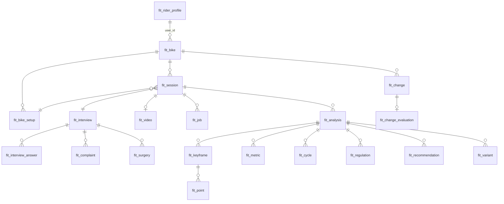

# 12 · Baza danych (MariaDB)

## 1. Konwencje

- Silnik InnoDB, `utf8mb4` / `utf8mb4_unicode_ci`, prefiks `fit_`.
- Klucze: `id BIGINT UNSIGNED AUTO_INCREMENT`. Czas: `DATETIME(3)` w UTC (`created_at`, `updated_at`).
- `user_id` = identyfikator konta ridemore.bike (`users.id`, typ zgodny z tabelą kont – do potwierdzenia, Q-01).
  Klucz obcy do `users` tylko, jeśli administrator platformy się zgodzi (D-04); w przeciwnym razie spójność
  zapewnia zadanie porządkowe (konto usunięte → usunięcie danych `fit_*`).
- Wszystkie zapytania przez PDO z parametrami; każda tabela z danymi użytkownika ma `user_id` (bezpośrednio lub
  przez rodzica) i indeks po nim.
- Migracje: `migrations/NNN_opis.sql`, tabela `fit_schema_migrations(version, applied_at)`, uruchamiane
  `php bin/fit-migrate.php`.
- Kolumny `*_json` typu `LONGTEXT` z `CHECK (JSON_VALID(...))` (zgodne ze starszym MariaDB).

## 2. Diagram relacji (uproszczony)

## 3. Tabele

### Użytkownik i profil

**`fit_role`** – role modułu (gdy nie pochodzą z platformy)
| Kolumna | Typ | Uwagi |
|---|---|---|
| `user_id` | BIGINT UNSIGNED PK | |
| `role` | ENUM('rider','fitter','admin') | domyślnie brak wiersza = rider |

**`fit_rider_profile`** – aktualne wymiary ciała (`docs/04`, rozdz. 3)
| Kolumna | Typ |
|---|---|
| `user_id` | BIGINT UNSIGNED PK |
| `height_cm`, `mass_kg`, `inseam_cm`, `arm_span_cm`, `sit_bone_cm`, `shoulder_width_cm`, `foot_length_cm` | DECIMAL(5,1) NULL |
| `shoe_eu` | DECIMAL(4,1) NULL |
| `birth_year` | SMALLINT NULL |
| `sex` | ENUM('female','male','undisclosed') NULL |
| `foot_arch` | ENUM('flat','medium','high') NULL |
| `leg_length_diff` | ENUM('no','yes','unknown') NULL |
| `leg_length_diff_side` | ENUM('left','right') NULL |
| `leg_length_diff_mm` | TINYINT UNSIGNED NULL |
| `updated_at` | DATETIME(3) |

**`fit_user_pref`** – preferencje (C-14, C-17)
| Kolumna | Typ | Uwagi |
|---|---|---|
| `user_id` | BIGINT UNSIGNED PK | |
| `notify_email` | TINYINT(1) | domyślnie 0 (opt-in) |
| `reminders_enabled` | TINYINT(1) | domyślnie 1 (pulpit) |
| `analytics_opt_out` | TINYINT(1) | domyślnie 0 |
| `updated_at` | DATETIME(3) | |

**`fit_consent`** – zgody (`docs/15`, rozdz. 4)
| Kolumna | Typ | Uwagi |
|---|---|---|
| `id` | PK | |
| `user_id` | BIGINT UNSIGNED, idx | |
| `kind` | ENUM('video_processing','health_data','keyframes_storage','model_feedback') | |
| `version` | VARCHAR(20) | wersja treści zgody |
| `granted_at`, `revoked_at` | DATETIME(3) NULL | |

### Rowery

**`fit_bike`** – kolumny z `docs/05`, rozdz. 1: `id`, `user_id` (idx), `name`, `type`, `size_label`, `model_year`,
`is_active`, `geo_stack_mm`, `geo_reach_mm`, `geo_seat_angle_deg`, `geo_head_angle_deg`, `geo_head_tube_mm`,
`geo_chainstay_mm`, `geo_bb_drop_mm`, `geo_wheelbase_mm` (DECIMAL(6,1) NULL), `wheel_size` ENUM, `tyre_width_mm`,
`created_at`, `updated_at`, `deleted_at` (miękkie usuwanie).

**`fit_bike_setup`** – wersja ustawienia (`docs/05`, rozdz. 2): `id`, `bike_id` (idx), `valid_from` DATETIME(3),
wszystkie parametry siodła, kierownicy, korb, pedałów, bloków (DECIMAL(6,1) NULL / ENUM / VARCHAR),
`cleat_shims_json`, `setback_ref` ENUM('nose','center'), `sources_json` (dla każdego pola: `user` / `video` /
`default`; brak = nieznane), wszystkie parametry `NULL` = „Nie wiem”, `created_by` ENUM('self','shop','fitter','import'), `created_at`.
Wersje są niezmienne (tylko INSERT).

**`fit_change`**
| Kolumna | Typ |
|---|---|
| `id` | PK |
| `bike_id` | idx |
| `setup_before_id`, `setup_after_id` | FK `fit_bike_setup` |
| `parameter` | VARCHAR(40) – kod z `docs/05` |
| `delta` | DECIMAL(6,1) – zmiana względna, wymagana |
| `value_before`, `value_after` | VARCHAR(40) NULL – gdy znana wartość wyjściowa |
| `unit` | VARCHAR(10) |
| `changed_at` | DATE |
| `performed_by` | ENUM('self','shop','fitter') |
| `reason` | ENUM('recommendation','discomfort','new_part','fitter_advice','other') |
| `reason_note` | VARCHAR(500) NULL |
| `recommendation_id` | FK `fit_recommendation` NULL |
| `predicted_json` | LONGTEXT NULL – przewidywane pomiary z wariantu (do oceny) |
| `created_at` | DATETIME(3) |

### Wywiad

**`fit_interview`**: `id`, `user_id`, `bike_id`, `kind` ENUM('full','short','quick'), `questionnaire_version`,
`upgrade_of_analysis_id` NULL (pełny wywiad uzupełniający szybki start), `safety_level`
ENUM('none','caution','stop') DEFAULT 'none', `safety_reasons_json` LONGTEXT NULL,
`profile` ENUM('comfort','neutral','endurance','sport','custom'), `weekly_hours`, `longest`, `priority`,
`flex_posterior_chain`, `flex_ankle`, `flex_hip_flexor`, `flex_thoracic` ENUM('good','limited','very_limited','unknown'),
`flex_asymmetry`, `flex_less_flexible` TINYINT(1), `injury_recent` TINYINT(1), `injuries_text` VARCHAR(500) NULL,
`rides_since_change` SMALLINT NULL, `status` ENUM('draft','complete'), `created_at`, `completed_at`.

**`fit_interview_answer`**: `id`, `interview_id` (idx), `code` VARCHAR(60), `side` ENUM('left','right') NULL,
`value_text` VARCHAR(60) NULL, `value_num` DECIMAL(8,2) NULL (dla testów – średnia prób), `trials_json` LONGTEXT
NULL (wyniki prób), `unit` VARCHAR(10) NULL. Unikalność (`interview_id`, `code`, `side`). Odpowiedzi `safety.*`
i metadane testów (`mob.*.helper`, `mob.*.pain`) zapisywane jako osobne kody.

**`fit_complaint`**: `id`, `interview_id` NULL, `comfort_id` NULL (jedno z dwóch), `region` VARCHAR(30),
`side` ENUM('left','right','both') NULL, `intensity` TINYINT (0–10), `onset` ENUM('start','m30','m60','h2','after'),
`type` ENUM('pain','numb','tingling','pressure') NULL, `duration_after` ENUM('none','lt2h','same_day','next_day')
NULL, `frequency` ENUM('rare','half','always') NULL, `off_bike` TINYINT(1) NULL, `is_primary` TINYINT(1) DEFAULT 0,
`location_note` VARCHAR(100) NULL.

**`fit_surgery`** (C-04): `id`, `interview_id` (idx), `type`
ENUM('acl','meniscus','knee_replacement','hip_replacement','spine','shoulder','foot_ankle','other'),
`side` ENUM('left','right','both') NULL, `performed_ym` CHAR(7) (RRRR-MM), `restrictions` TINYINT(1).

### Sesja, plik, kolejka

**`fit_session`**: `id`, `user_id` (idx), `bike_id`, `setup_id`, `interview_id`, `status`
ENUM('draft','uploaded','queued','processing','done','done_warnings','failed','cancelled'), `side`, `grip`,
`markers_mode`, `markers_skipped_json` (kody punktów pominiętych w kreatorze), `scale_marker_mm`, `cadence_target_rpm`, `recording_rpe` TINYINT NULL, `recording_power_w`
SMALLINT NULL, `upload_device` ENUM('desktop','phone') NULL,
`video_retention` ENUM('delete_after','keyframes_only','keep') DEFAULT 'delete_after',
`checklist_json`, `current_analysis_id` NULL, `points_confirmed_at` NULL, `created_at`, `updated_at`.

**`fit_upload`**: `id`, `user_id`, `session_id`, `size_bytes`, `chunk_bytes`, `chunks_total`, `chunks_received`,
`status` ENUM('open','complete','aborted'), `created_at`, `expires_at`.

**`fit_video`**: `id`, `session_id` (unik.), `storage_path` VARCHAR(255), `size_bytes`, `sha256` CHAR(64),
`container` ENUM('mp4','mov'), `duration_s`, `fps`, `width`, `height`, `codec` (z wyniku analizy),
`delete_after` DATETIME(3) NULL, `deleted_at` NULL, `created_at`.

**`fit_job`**
| Kolumna | Typ | Uwagi |
|---|---|---|
| `id` | PK | |
| `session_id` | idx | |
| `user_id` | idx | |
| `type` | ENUM('analyze','correct','refit','simulate') | |
| `status` | ENUM('queued','running','done','done_warnings','failed','cancelled') | idx (`status`, `run_after`, `priority`) |
| `priority` | TINYINT | 10 interaktywne, 0 analiza |
| `attempts`, `max_attempts` | TINYINT | domyślnie 0 / 3 |
| `run_after` | DATETIME(3) | opóźnienie ponowienia |
| `claim_token` | CHAR(32) NULL | |
| `active_key` | VARCHAR(40) NULL, `UNIQUE` | `"{session_id}:{type}"` dla `queued`/`running`, `NULL` w stanach końcowych (`docs/02`, rozdz. 5.1) |
| `claimed_at`, `heartbeat_at`, `started_at`, `finished_at` | DATETIME(3) NULL | |
| `progress` | DECIMAL(4,3) | 0–1 |
| `stage` | VARCHAR(20) NULL | |
| `input_json` | LONGTEXT NULL | parametry `correct`/`simulate` |
| `base_analysis_id` | NULL | |
| `result_analysis_id` | NULL | |
| `error_code` | VARCHAR(40) NULL | |
| `error_details` | VARCHAR(500) NULL | bez danych osobowych |
| `created_at` | DATETIME(3) | |

### Wynik analizy

**`fit_analysis`**: `id`, `session_id` (idx), `user_id` (idx), `job_id`, `parent_id` NULL, `kind`
ENUM('analyze','correct','refit','simulate'), `is_current` TINYINT(1), `schema_version`, `algorithm_version`,
`pose_model`, `pose_model_version`, `fit_model_version`, `pipeline_config_hash`, `profile`,
`fit_level` ENUM('basic','full'), `safety_level` ENUM('none','caution','stop'), `status`
ENUM('ok','ok_with_warnings'), `quality_overall` ENUM('good','warn','bad'), `frames_ok_pct`, `cycles_total`,
`cycles_valid`, `scale_px_per_mm`, `scale_source` ENUM('marker','crank','wheel','body','crank_default','none'), `scale_sources_json`, `camera_yaw_deg`, `rectified` TINYINT(1), `camera_tilt_deg`, `tilt_source`, `direction`,
`video_duration_s`, `video_fps`, `video_width`, `video_height`, `fragment_start_s`, `fragment_end_s`,
`processing_ms`, `warnings_json`, `body_model_json`, `plan_json` (plan sekwencyjny, `docs/09`, rozdz. 11),
`result_path`, `created_at`.

**`fit_keyframe`**: `id`, `analysis_id` (idx), `phase` ENUM('tdc','p90','bdc','p270'), `frame_index`, `time_s`,
`image_path` NULL (NULL po usunięciu), `width`, `height`, `image_deleted_at` NULL. Unikalność (`analysis_id`, `phase`).

**`fit_point`**: `id`, `keyframe_id` (idx), `code`, `x_px`, `y_px`, `x_mm`, `y_mm` DECIMAL(8,2),
`source` ENUM('marker','model','interpolated','manual','missing'), `confidence` DECIMAL(4,3), `note` VARCHAR(40) NULL.

**`fit_metric`**: `id`, `analysis_id` (idx), `code`, `rep` ENUM('med','max','min','rom','at_p90','at_bdc'),
`value` DECIMAL(8,2) NULL, `sd` DECIMAL(8,2) NULL, `unit` ENUM('deg','mm','pct'), `quality`
ENUM('good','warn','bad','na'), `validation_status` ENUM('validated','unvalidated','hidden'), `n_cycles` SMALLINT. Unikalność (`analysis_id`, `code`, `rep`).

**`fit_cycle`**: `analysis_id`, `n`, `valid`, `reject_reason`, `t_start_s`, `t_end_s`, `cadence_rpm`. PK (`analysis_id`, `n`).

**`fit_analysis_modifier`**: `analysis_id`, `code`, `text_key`. PK (`analysis_id`, `code`).

**`fit_regulation`**: `id`, `analysis_id`, `code` ENUM('saddle_height','saddle_fore_aft','bar_reach','bar_height'),
`status` ENUM('ok','near','out','unknown','accepted'), `direction` ENUM('below','above') NULL, `value`, `unit`,
`green_lo`, `green_hi`, `yellow_lo`, `yellow_hi`, `target`, `disputed_json`, `method`, `evidence`,
`rule_status` ENUM('measure_only','experimental','validated'), `rationale_json`, `flags_json`.

**`fit_recommendation`**: `id`, `analysis_id` (idx), `order_no`, `regulation`, `action_key`, `param`, `amount_mm`,
`amount_total_mm`, `variant_key`, `title`, `why`, `how` (teksty wyrenderowane w chwili analizy), `blocked_by` NULL,
`confidence` ENUM('high','medium','low'), `confidence_reasons_json`, `effort_json`, `rule_status`,
`side_effects_json`, `rationale_json`, `is_next_step` TINYINT(1).

**`fit_variant`**: `id`, `analysis_id` (idx), `variant_key` VARCHAR(40) (np. `stem_length_mm:-10`), `param`, `value`,
`delta`, `approximate`, `geometry_json` (geometria roweru – wynik dokładny), `metrics_json` (przewidywanie),
`prediction_validated` TINYINT(1), `statuses_json`, `loads_json`, `flags_json`, `skeleton_json`.
Unikalność (`analysis_id`, `variant_key`).

### Korekty, akceptacje, plany

**`fit_point_correction`**: `id`, `analysis_id` (bazowa), `user_id`, `phase`, `point_code`, `x_px`, `y_px`,
`scope` ENUM('all_frames','keyframe'), `job_id`, `result_analysis_id` NULL, `created_at`.

**`fit_acceptance`**: `id`, `user_id`, `bike_id`, `regulation`, `reason`
ENUM('anatomy','injury','leg_length','mobility','comfortable'), `note` VARCHAR(300) NULL, `created_at`, `revoked_at` NULL.

**`fit_plan`** / **`fit_plan_item`**: plan zmian z S12 lub okna „Zaplanuj”: `fit_plan(id, user_id, analysis_id,
status ENUM('draft','saved','applied'), planned_date DATE NULL, test_rides TINYINT DEFAULT 3, created_at)`, `fit_plan_item(plan_id, param, value_before, value_after, unit, variant_key, estimate TINYINT(1))`.

**`fit_simulation`**: wynik dokładnego przeliczenia kombinacji: `id`, `analysis_id`, `changes_json`, `job_id`,
`result_json` NULL, `created_at`.

### Komfort, ocena zmian, przypomnienia

**`fit_comfort`**: `id`, `user_id`, `session_id` NULL, `setup_id`, `ride_type` VARCHAR(60), `duration_min`,
`created_at`; pozycje w `fit_complaint` (`comfort_id`).

**`fit_ride_feedback`**: `id`, `user_id`, `change_id`, `ride_date` DATE,
`feeling` ENUM('much_better','better','same','worse','much_worse'), `target_intensity` TINYINT NULL (0–10, siła
głównej dolegliwości), `note` VARCHAR(300) NULL.

**`fit_change_evaluation`**: `id`, `change_id` (lub grupa: `setup_after_id`), `analysis_before_id`,
`analysis_after_id`, `verdict` ENUM('effective','partial','no_effect','worse','too_early'), `comparable` TINYINT(1),
`criteria_json`, `rides_count`, `created_at`.

**`fit_reminder`**: `id`, `user_id`, `kind` ENUM('planned_change','control_recording','ride_feedback'), `due_at`,
`change_id` NULL, `plan_id` NULL, `channel` ENUM('dashboard','email'), `sent_at` NULL, `dismissed_at` NULL.
Najwyżej `notifications.max_per_change` (2) przypomnienia na zmianę lub plan; e-mail tylko przy
`fit_user_pref.notify_email = 1` (D-11).

**`fit_model_feedback`** (anonimowe, za zgodą `model_feedback`): `id`, `fit_model_version`, `param`, `delta`,
`metric`, `predicted_delta`, `measured_delta`, `created_at` – bez `user_id`.

**`fit_share`** (po MVP, D-13): `id`, `owner_user_id`, `fitter_user_id`, `session_id` NULL (NULL = wszystkie),
`scope` ENUM('view','verify','custom_profile'), `created_at`, `revoked_at`.

**`fit_event`** (C-17) – zdarzenia produktowe, **bez danych o zdrowiu**: `id`, `user_id` (idx), `event`
VARCHAR(40) z białej listy (np. `interview.step_completed`, `interview.completed`, `analysis.submitted`,
`analysis.failed`, `points.confirmed`, `result.viewed`, `plan.saved`, `change.saved`, `ride.rated`,
`evaluation.viewed`, `upload.phone`), `props_json` (tylko klucze z białej listy: `step`, `kind`, `duration_ms`,
`error_code`, `quality`, `verdict`, `fit_level`), `created_at`. Zakazane w `props_json`: obszary i siła
dolegliwości, odpowiedzi bezpieczeństwa, wyniki testów, pomiary. Brak zapisu przy `analytics_opt_out = 1`.

**`fit_audit_log`**: `id`, `user_id`, `action` VARCHAR(40) (np. `video.deleted`, `correction.created`,
`consent.revoked`), `object_type`, `object_id`, `created_at` – bez treści danych o zdrowiu.

## 4. Retencja (zadanie `bin/fit-retention.php`, cron co godzinę)

| Obiekt | Reguła |
|---|---|
| fragmenty przesyłania | `fit_upload.expires_at` (24 h) → usunięcie plików i rekordu |
| wideo `delete_after` | po zakończeniu `analyze` sukcesem; po porażce – `retention.failed_video_days` |
| kadry przy `delete_after` | po `points_confirmed_at` lub po `retention.keyframes_grace_days` |
| kadry przy `keyframes_only` / `keep` | do usunięcia przez użytkownika lub konta |
| katalogi zadań `jobs/{id}` | 30 dni po zakończeniu (poza `result.json` przeniesionym do `results/`) |
| `fit_event` | 12 miesięcy, potem usunięcie (agregaty bez `user_id` mogą zostać) |
| konto usunięte | wszystkie dane `fit_*` i pliki użytkownika – w ciągu 24 h |
Każde usunięcie pliku → `fit_audit_log`.
